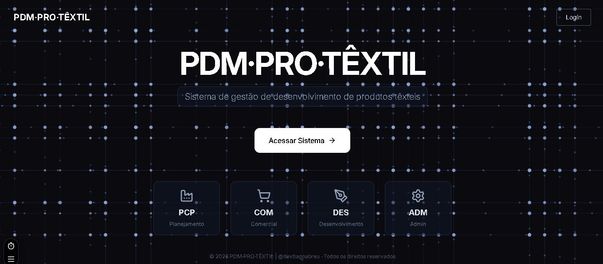

# PDM Pro Têxtil



Sistema de gestão do desenvolvimento de produtos têxteis (PDM — Product Development Management). Conecta os departamentos **Comercial**, **Desenvolvimento (Tecelagem e Beneficiamento)**, **PCP**, **CRM**, **Manutenção** e **Engenharia de Processos** em uma plataforma única, eliminando retrabalhos e garantindo rastreabilidade completa do briefing à produção — com **Inteligência Artificial**, **BI**, **integração com ERPs** e **assistente de WhatsApp** embarcados.

[](https://nextjs.org/)
[](https://www.typescriptlang.org/)
[](https://react.dev/)
[](https://tailwindcss.com/)
[](https://orm.drizzle.team/)
[](https://www.postgresql.org/)
[](https://vitest.dev/)
[](https://vercel.com/)
[](LICENSE)

---

## Visão geral

| Módulo | Rota | O que faz |
|--------|------|-----------|
| Dashboard | `/dashboard` | Indicadores e relatórios de desenvolvimento |
| Comercial | `/comercial` | Solicitações, clientes, representantes, requisições de corte e amostra |
| CRM | `/comercial/crm` | Funil de vendas completo: leads, pessoas, oportunidades, propostas, visitas, viagens, faturamentos e pedidos |
| Cadastros | `/cadastros` | Engenharia têxtil: fios, cores, estampas, produtos, receitas, químicos |
| Amostras | `/amostras` | Amostras de desenvolvimento (listagem + kanban) |
| Ativos e Vistorias | `/ativos` | Ativo imobilizado, depreciação (CPC 27) e vistorias periódicas |
| Chamados | `/chamados` | Helpdesk de TI e manutenção com filas, SLA e thread de atendimento |
| Engenharia de Processos | `/processos` | Hierarquia de processos e studio de diagramas (Mermaid / BPMN / canvas) |
| Reuniões | `/reunioes` | Repositório de reuniões: pauta, ata, encaminhamentos, vídeo e links |
| BI | `/bi` | Leitura de Google Sheets com consultas, curva ABC e previsões |
| Documentos | `/documentos` | Romaneios, conferência de OP de tecido cru, pré-DANFE |
| Ferramentas | `/ferramentas` | Regra de três, numeração de fio, consulta CNPJ, NF-e → CT-e, e-mail em massa |
| Chat | `/chat` | Chat corporativo por entidade com @mention |
| Administração | `/admin` | Usuários, permissões, integrações, WhatsApp, IA, e-mail e logs |
| Perfil | `/perfil` | Dados do usuário, senha e menus personalizados |

---

## Funcionalidades

### Módulo Comercial
- **Solicitações de Desenvolvimento** — briefing completo dividido em 8 seções (Tecelagem e Beneficiamento), com anexos (PDF, DOCX, XLSX, JPG, PNG, MP4 via Vercel Blob) e links incorporados (YouTube, Google Sheets, Docs, Agenda)
- **Kanban de Solicitações** — arraste e solte para avançar etapas do desenvolvimento
- **Detalhe da Solicitação** — linha do tempo de status, histórico de comunicação, produtos vinculados, chat por entidade
- **Requisições de Amostra Comercial** — solicitação de amostras para clientes com kanban de acompanhamento
- **Requisições de Corte** — requisições com itens e geração de PDF, com visão **por romaneio**
- **Clientes** — cadastro completo com importação via API externa e modelo de planilha
- **Representantes** — cadastro com vínculo a clientes e pessoas (PF/PJ) e notificação de novos leads

### CRM (Comercial)
- **Leads** — captura, kanban de acompanhamento e **score com IA** (prioridade, segmento e porte classificados automaticamente)
- **Pessoas e Contatos** — cadastro de PF/PJ com timeline de interações, busca de CNPJ (OpenCNPJ) e integração com Google Drive
- **Oportunidades, Propostas e Pedidos de Venda** — funil de vendas completo com kanbans arrastáveis
- **Faturamentos** — faturamento de pedidos com itens e acompanhamento
- **Visitas** — planejamento (duração estimada, localização), relato com templates, pesquisa de satisfação e visitas avulsas com vínculo posterior
- **Viagens** — cronograma de visitas da viagem com rota em mapa e controle de investimentos
- **Tarefas, Campanhas e Segmentos** — organização do time comercial com kanbans e notificações
- **Equipes, Regiões e Localidades** — estrutura organizacional com países, estados e cidades
- **Conversas WhatsApp** — histórico das conversas do bot por contato
- **IA do CRM** — classificação de leads, **previsão de vendas**, reativação de clientes e resumo automático de pessoas
- **Treinamento** — módulos e lições com trilhas de aprendizado e exportação em PDF
- **Relatórios CRM** — indicadores de funil, vendas, visitas e campanhas

### Módulo de Amostras (Desenvolvimento)
- **Listagem de Amostras** — tabela com abas Tecido Cru / Acabamento, links para a ficha técnica, filtros por status e geração de PDF "Solicitação de Amostra"
- **Kanban de Amostras** — arraste e solte por colunas de status configuráveis
- **Vínculo com Produto** — cada amostra pertence a um produto cru (tecido ou acabamento) com rastreabilidade completa
- **Avanço Automático** — ao mover amostra para "Em Produção", a solicitação vinculada avança para "Pilotagem"

### Módulo de Cadastros (Engenharia Têxtil)
- **Fios** — composição, titulagem (Ne, Nm, Tex), NCM, fornecedores vinculados, importação em lote
- **Cores** — sólidas e de fundo com código, pantone, família de cor, importação em lote
- **Estampas** — desenhos com variantes e imagens, importação em lote
- **Bases de Urdume** — cadastro com fios associados, importação em lote
- **Fornecedores** — cadastro com importação em lote
- **Acabamentos** — categorizados por tipo (químico, mecânico, lavagem etc.)
- **Máquinas e Operações** — cadastro técnico do beneficiamento
- **Produtos Químicos** — concentração, densidade, pH, FISPQ, importação em lote
- **Produtos (Tecidos/Malhas)** — ficha técnica completa do produto cru:
  - Composição (liga de fios com percentuais)
  - Estrutura têxtil (trama, urdume, batidas, gramatura)
  - Amostras de tecido cru (com status, links, motivos, PDF)
  - Acabamentos vinculados (com receitas e amostras de acabamento)
  - Receitas de beneficiamento versionadas
- **Receitas** — receitas de beneficiamento com itens, estágios, produtos químicos, versionamento e duplicação

### Módulo Ativos e Vistorias
- **Ativos** — código único, nome, categoria (com setor responsável), localização, fabricante/modelo/nº de série, status (ATIVO, MANUTENÇÃO, INATIVO, BAIXADO) e máquina opcional
- **Controle de Depreciação** — cálculo automático (linha reta): base depreciável, depreciação mensal/anual, acumulada, percentual depreciado, projeção anual e fim estimado da vida útil
- **Reformas (CPC 27)** — reforma que estende a vida útil ou amplia a capacidade é **capitalizada** (soma ao custo e reativa a depreciação sobre a nova vida útil); manutenção rotineira (extensão 0) fica fora do cálculo
- **Vistorias periódicas** — tipos de vistoria (checklist, periodicidade e base legal) → planos (ativo × tipo) → ocorrências agendadas com janela de 12 meses e alerta de atrasadas
- **Dashboard de Ativos** — vistorias atrasadas/próximas/concluídas, canceladas e ativos por status

### Módulo de Chamados (TI e Manutenção)
- **Abertura de chamados** — título, descrição, categoria, prioridade e fila de atendimento (setor de `proc_areas`), com vínculo opcional a ativo e processo
- **Thread de atendimento** — respostas, notas internas do responsável e mensagens automáticas do sistema, com anexos por link
- **SLA em duas etapas** — prazo de **primeira resposta** (horas úteis) e de **resolução** (horas corridas conforme a prioridade)
- **Ciclo de vida** — Aberto → Em andamento → Aguardando → Resolvido → Fechado, além de Reaberto e Cancelado (fechar/reabrir/cancelar substituem a exclusão)
- **Categorias** — cadastro de tipos de chamado com código, cor e ordem
- **Dashboard de Chamados** — totais, distribuição por status, prioridade e fila

### Módulo de Engenharia de Processos
- **Hierarquia padronizada** — Empresa → Site → Área → Processo → Subprocesso → Atividade, com o **Processo** como objeto central (objetivo, responsável, entradas/saídas, fornecedores, clientes, indicadores, riscos e controles)
- **Process Studio** (`/processos/visual`) — diagramas derivados de um **modelo semântico** que é a fonte única da verdade
- **Múltiplos formatos** — **Mermaid**, **BPMN 2.0** (editor `bpmn-js` com persistência de estilos) e **canvas Excalidraw** para desenho à mão livre
- **Resumo markdown** — geração de texto do processo para documentação
- **Treinamento** — trilhas internas do módulo com exportação em PDF

### Módulo de Reuniões
- **Repositório de reuniões** — internas e de projetos (Systêxtil, Bling, outros), ordenadas por data
- **Pauta, participantes e local** — o que será discutido e quem participa
- **Ata e resumos** — resumo curto (1 frase), detalhado (com citações) e de itens de ação (PDCA)
- **Encaminhamentos** — tarefas com responsável, prazo e status (Pendente / Em andamento / Concluído)
- **Transcrição, vídeo e links úteis** — gravação e materiais de referência atalháveis
- **Projetos de Reuniões** — cadastro de projetos com datas, status e cor

### Módulo BI
- **Leitura de Google Sheets** — carrega todas as abas da planilha (descoberta automática de GIDs) com os nomes reais
- **Consultas** — por produto, por grupo (clientes do grupo com data da última compra), por representante e por cliente
- **Filtro por período** — baseado na coluna `DATA_MOVTO` com data inicial/final e atalhos (mês atual, mês passado, trimestre, semestre, 12 meses)
- **Indicadores** — cards de métricas, tendência mensal, distribuição geográfica, **curva ABC**, curva de compra dos clientes e **previsões**
- **Cache em Postgres** — tabela `bi_sheets` com TTL configurável em `config_geral` (padrão 10 min)

### Inteligência Artificial
- **Chaves de IA multi-provedor** — cadastro de chaves com **fallback automático** entre provedores em caso de falha
- **Provedores suportados** — Groq (Llama), OpenAI (GPT), Anthropic (Claude), Gemini e DeepSeek (compatível com OpenAI)
- **Gestão** — ordem de prioridade, ativação/desativação, contador de falhas e teste de conexão por chave
- **Uso no sistema** — bot de WhatsApp, classificação de leads, previsão de vendas e resumo de pessoas

### WhatsApp / Evolution API
- **Bot com IA** — webhook próprio com máquina de estados, controle de abandono e fila de retry (drenada por cron)
- **Catálogo de produtos** — catálogo WhatsApp vinculado a linhas e tipos de pessoa
- **Monitoramento** — dashboard com estados das conversas e monitor com passos do fluxo, além do chat e da configuração do bot (`/admin/bot-config`)
- **Notificações** — novos leads para representantes via WhatsApp (PJ e PF)

### Chat Corporativo
- **Chat por Entidade** — conversas vinculadas a solicitações ou produtos
- **Mensagens com @mention** — autocomplete de usuários ativos, suporte a acentos e destaque visual
- **Notificações** — ao mencionar alguém com `@Nome`, o usuário recebe notificação in-app e e-mail com link direto
- **Editar / Apagar** — própria mensagem dentro da janela de 5 minutos
- **Indicador de Não Lidas** — badge no header e ícone de visualizado (duplo check)
- **Emoji Picker** — seletor de emojis integrado

### Dashboard e Indicadores
- **Dashboard Principal** — totais do mês, pendentes, em desenvolvimento, pilotagem, concluídos e produtos CAD
- **Gráficos** — tendência mensal (linha), distribuição por status (barras) e por tipo (pizza)
- **Atividades Recentes** — feed com as últimas movimentações
- **Dashboards específicos** — Amostras, Amostra Comercial, Requisições de Corte, CRM, Ativos e Chamados

### Relatórios (10 tipos)
- Solicitações Criadas (período)
- Solicitações por Status
- Solicitações Concluídas
- Histórico de Solicitação (auditoria completa)
- Amostras por Status
- Amostra Comercial por Status
- Histórico de Amostra
- Tempo em Status (solicitações e amostras)
- Atividade por Usuário
- Relatórios CRM (funil, vendas, visitas, campanhas)

### Documentos
- **Romaneios de Expedição** — consulta via integração com ERP, agrupamento por lote com subtotais, grade de rolos (metragem, pesos, largura, endereço) e PDF retrato/paisagem
- **Conferência de OPs de Tecido Cru** — confere as OPs que geraram rolos de tecido cru (tecelagem ou beneficiamento), com leitura de **código de barras pela câmera**, agrupamento por OP e filtro por rolo; funciona no desktop e no celular
- **Pré-DANFE, Pedidos de Venda/Compra e Relatórios operacionais** — em preparação ("Em breve")
- **Google Drive** — navegação e listagem de arquivos/pastas integrada ao módulo

### Ferramentas
- **Calculadora de Regra de Três** — simples (direta/inversa) e composta
- **Conversor de Numeração de Fio** — entre Ne, Nm, Tex, Dtex e Denier
- **Consulta CNPJ** — consulta na Receita Federal, comparação com registros locais e sincronização
- **NF-e → CT-e por Período** — relatório fiscal/logístico que lista as NF-e com CT-e, transportadora, tomador, fornecedor, rateio, **% do CT-e**, **CFOP** e **frete sobre a mercadoria** (com faixa 1,5%–2,0%), abas por região e por CFOP, ordens de despacho e exportação em CSV/PDF
- **Email em Massa** — envio para múltiplos destinatários com listas e modelos (ver Administração)

### Administração
- **Usuários** — CRUD completo com perfis de acesso
- **Perfis (Roles)** — gestão de papéis (ADMIN, SUDO, COMERCIAL, TECELAGEM, BENEFICIAMENTO, PCP, CRM, DESENVOLVIMENTO)
- **Permissões** — controle CRUD granular por perfil e módulo
- **Telas / Menus** — configuração de menus por perfil com drag-and-drop, reordenação e página inicial personalizada
- **Status** — gerenciamento de fluxos de status por módulo
- **Empresa** — logo, CNPJ, endereço e dados fiscais para relatórios e exportações
- **SMTP / E-mail** — servidor de e-mail com teste de envio; detecção de **bounces** por IMAP gera opt-outs automáticos
- **Integrações** — conexões com sistemas externos (ERP, API, WMS) por endpoints configuráveis
- **Notificações** — regras de quem recebe cada tipo de notificação
- **Banco de Dados** — gerenciamento de conexões, criação, clone e backup
- **Email em Massa** — listas, modelos, editor, envio imediato e **agendamento** com barra de progresso
- **Chaves de IA** — provedores com fallback automático
- **WhatsApp** — dashboard de conversas, monitor de fluxos, chat, catálogos e configuração do bot
- **Logs de Auditoria** — rastreamento de todas as ações no sistema

### Kanbans Standalone
- **Abrir em janela própria** — kanbans de solicitações, amostras e CRM podem ser abertos em aba separada, sincronizados via `BroadcastChannel` em tempo real

### Perfil do Usuário
- **Dados do Perfil** — visualizar nome, email e perfil
- **Alterar Senha** — com gerador de senha segura e mostrar/ocultar
- **Menus Personalizados** — criar, editar e reordenar menus com drag-and-drop

---

## Integrações

| Sistema | Uso no PDM |
|---------|------------|
| **Systêxtil (IPLM + Full)** | Importação e consulta de dados do ERP: pessoas, materiais, vendas, fiscal, industrial, rolos e romaneios |
| **Bling (API v3)** | OAuth 2.0 e integração de pedidos, notas, contatos, produtos, financeiro e logística |
| **Kipflow** | Consulta de dados empresariais (CNPJ e LinkedIn) |
| **OpenCNPJ / Receita Federal** | Consulta de CNPJ em cadastros e na ferramenta de consulta |
| **Google** | Login OAuth, Google Drive (arquivos) e Google Sheets (BI) |
| **Evolution API** | WhatsApp: envio/recebimento e catálogos do bot |
| **Vercel Blob** | Armazenamento de anexos e imagens |
| **IMAP** | Leitura de caixas de e-mail para detectar bounces e alimentar opt-outs |

---

## Stack

| Camada | Tecnologia |
|--------|------------|
| Frontend / Backend | Next.js 15 (App Router) |
| Linguagem | TypeScript 5 |
| UI | React 19 + Tailwind CSS 3.4 + shadcn/ui + Base UI + Radix |
| ORM | Drizzle ORM 0.45 |
| Database | PostgreSQL (Neon Serverless) — **4 bancos** |
| Auth | NextAuth.js 4 (Credentials + Google OAuth + JWT) |
| Storage | Vercel Blob |
| PDF | jsPDF + jspdf-autotable |
| Gráficos | Recharts |
| Mapas | Leaflet |
| Diagramas | bpmn-js + Excalidraw + Mermaid |
| Código de barras | @zxing/browser |
| Captura de tela | html2canvas |
| Formulários | React Hook Form + Zod |
| Drag & Drop | dnd-kit |
| Tabelas | TanStack Table |
| Upload | react-dropzone |
| Notificações | Sonner (toast) |
| Cache/Estado | TanStack Query |
| E-mail | Nodemailer + ImapFlow (bounces) |
| Criptografia | AES-256-GCM |
| Planilhas | googleapis (Google Sheets) |
| IA | OpenAI / Anthropic / Google / Groq / DeepSeek (fallback automático) |
| WhatsApp | Evolution API |
| Markdown | react-markdown + remark-gfm |
| Testes | Vitest + Testing Library |
| Hospedagem | Vercel |

---

## Estrutura

```
src/
├── app/
│   ├── (dashboard)/           # Área logada (protegida por middleware)
│   │   ├── admin/             # Usuários, roles, logs, notificações, e-mail em massa
│   │   │   ├── configuracoes/ # SMTP, BD, permissões, empresa, telas, status, IA, integrações
│   │   │   ├── email-massa/   # Listas, modelos, agendamento e progresso de envio
│   │   │   ├── bot-config/    # Configuração do bot de WhatsApp
│   │   │   ├── whatsapp-*/    # Dashboard, monitor, chat e catálogos do WhatsApp
│   │   │   └── logs/          # Logs de auditoria
│   │   ├── amostras/          # Listagem e kanban de amostras
│   │   ├── ativos/            # Ativos, vistorias, planos, categorias, dashboard
│   │   ├── bi/                # Módulo BI (Google Sheets)
│   │   ├── cadastros/         # Fios, cores, estampas, produtos, receitas...
│   │   ├── chamados/          # Chamados, categorias e dashboard
│   │   ├── chat/              # Chat corporativo
│   │   ├── comercial/         # Solicitações, clientes, representantes, cortes
│   │   │   └── crm/           # Leads, pessoas, oportunidades, propostas, pedidos,
│   │   │                      # faturamentos, visitas, viagens, campanhas, treinamento
│   │   ├── dashboard/         # Dashboard + relatórios
│   │   ├── documentos/        # Romaneios, conferência de OP, pré-DANFE
│   │   ├── ferramentas/       # Regra de três, conversores, CNPJ, NF-e → CT-e
│   │   ├── processos/         # Empresas, sites, áreas, processos, treinamento, studio visual
│   │   ├── reunioes/          # Reuniões e projetos
│   │   └── perfil/            # Perfil, senha, menus personalizados
│   ├── api/                   # API Routes (300+ endpoints)
│   │   ├── admin/  amostras/  ativos/  bi/  cadastros/  chamados/  chats/
│   │   ├── clientes/  comercial/  crm/  dashboard/  db/  email/
│   │   ├── google-drive/  integracao/  notificacoes/  perfil/  processos/
│   │   ├── proxy-image/  receitas/  relatorios/  representantes/  reunioes/
│   │   └── requisicoes-amostra-comercial/  solicitacoes/  user/  usuarios/
│   ├── kanban-*/              # Kanbans standalone (solicitações, CRM, amostras)
│   ├── login/                 # Página de login
│   └── page.tsx               # Landing page
├── components/                # bi, chat, crm, exportar, forms, importar, kanban,
│                              # layout, links, receita, ui + providers
├── hooks/                     # Hooks (use-statuses)
├── lib/
│   ├── ai/  bi/  crm/  whatsapp/  google-drive/  ativos/
│   ├── db/
│   │   ├── schema/            # 126 tabelas (Drizzle)
│   │   ├── index.ts           # Conexão com banco
│   │   └── seed.ts            # Dados iniciais
│   ├── info-content/          # Ajuda contextual por tela
│   ├── search-registry.ts     # Registro da busca global
│   ├── auth.ts  email.ts  email-bounces.ts  notificar.ts  log.ts  crypto.ts
│   ├── validation.ts  error-handler.ts  api-error.ts  db-admin.ts
│   ├── status-utils.ts  export-utils.ts  utils.ts  gerar-*-pdf.ts
│   └── ...
├── middleware.ts              # Proteção de rotas (NextAuth)
└── types/                     # Tipos TypeScript
```

---

## Banco de Dados (126 tabelas)

```
🔐 Usuários e Acesso
  usuarios, accounts, sessions, roles,
  user_menus, user_menu_itens, user_email_config

📄 Solicitações e Desenvolvimento
  solicitacoes, anexos, clientes,
  requisicoes_corte, requisicoes_corte_itens, requisicoes_amostra_comercial

🧵 Cadastro Técnico
  fios, fios_fornecedores, fornecedores, cores_solidas, cores_fundo,
  acabamentos, maquinas, operacoes, bases_urdume, base_urdume_fios,
  estampas, produtos_quimicos

🏭 Produto Cru (Engenharia)
  produtos_cru, produto_cru_composicao, produto_cru_estrutura,
  produto_cru_amostra, produto_cru_acabamento, produto_cru_acabamento_amostra,
  produto_cru_receita, produto_cru_receita_item, produto_cru_acabamento_receita

🏭 Ativos e Vistorias
  ativos_categorias, ativos, ativos_tipos_vistoria,
  ativos_planos_vistoria, ativos_vistorias, ativos_reformas

🎫 Chamados
  chamado_categorias, tickets, ticket_mensagens

🏗️ Engenharia de Processos
  proc_empresas, proc_sites, proc_areas, proc_processos,
  proc_subprocessos, proc_atividades, proc_diagramas,
  proc_treino_modulos, proc_treino_licoes

📅 Reuniões
  reunioes, reunioes_projetos, reuniao_pautas, reuniao_participantes,
  reuniao_encaminhamentos, reuniao_links, reuniao_atas

👥 CRM
  crm_leads, crm_pessoas, crm_contatos, crm_oportunidades, crm_propostas,
  crm_pedidos_venda, crm_pedido_venda_itens, crm_faturamentos, crm_faturamento_itens,
  crm_visitas, crm_visitas_localizacoes, crm_viagens, crm_viagens_investimentos,
  crm_tarefas, crm_campanhas, crm_segmentos, crm_equipes, crm_equipe_membros,
  crm_estados, crm_cidades, crm_paises, crm_regioes,
  crm_pesquisas_satisfacao, crm_pesquisas_respostas,
  crm_treino_modulos, crm_treino_licoes, crm_notificacoes,
  crm_timeline_eventos, crm_previsao_vendas, crm_email_config

🤖 WhatsApp / IA
  crm_whatsapp_mensagens, crm_whatsapp_conversas, crm_whatsapp_catalogos,
  crm_whatsapp_linhas, crm_whatsapp_fila, crm_whatsapp_retry_queue,
  crm_whatsapp_destinatarios, crm_whatsapp_bot_logs, crm_whatsapp_flow_logs,
  ai_chaves, bi_sheets

🛒 Representantes
  representantes, clientes_representantes, pessoas_representantes

📧 E-mail
  email_config, email_modelos, email_listas, email_lista_contatos,
  email_enviados, email_cliques, email_agendados, email_disparos,
  email_optouts, user_email_config

📦 Documentos
  romaneios, romaneio_pecas

💬 Chat
  chats, chat_mensagens, chat_participantes, chat_leituras

⚙️ Administração
  integracoes, config_empresa, config_geral, notificacoes, notificacao_regras,
  logs, bancos_dados, status
```

---

## Multi-database (4 bancos PostgreSQL)

O PDM opera sobre **quatro bancos PostgreSQL**, e **toda mudança de schema do
banco principal deve ser replicada para os outros três**:

| Banco | Uso | Variável |
|-------|-----|----------|
| `pdm_textil` | Instância principal | `DATABASE_URL` |
| `pdm_pro_textil` | PDM Pro Têxtil (produção) | `DATABASE_URL_PDM_PRO_TEXTIL` |
| `pdm_ibirapuera` | PDM Ibirapuera (produção) | `DATABASE_URL_PDM_IBIRAPUERA` |
| Neon | Banco auxiliar (produção) | `DATABASE_URL_NEON` |

Procedimento padrão:

```bash
npx drizzle-kit generate      # 1. gera a migration
npm run db:migrate            # 2. aplica no principal (pdm_textil)
npm run db:migrate:all        # 3. replica nos secundários
node scripts/sync-all-dbs.js  # 4. cria colunas/tabelas faltantes no Neon (IF NOT EXISTS)
node scripts/compare-schemas.js   # 5. confere as colunas entre os 4 bancos
```

A pasta `scripts/` reúne **140+ utilitários** operacionais (migrations avulsas,
diagnósticos, seeds, geocodificação de visitas, sync/compare de schema, backup e
restore).

---

## Automação (Cron e CI)

Além dos endpoints agendáveis, o projeto usa **GitHub Actions** para o que o cron
do Vercel (plano Hobby, 1x/dia em UTC) não cobre:

| Workflow | Frequência | Função |
|----------|-----------|--------|
| `ci.yml` | push/PR na `main` | Lint, type-check e testes |
| `email-massa.yml` | a cada 15 min | Converte agendamentos e processa a fila de e-mail |
| `chamados-sla.yml` | a cada 15 min | Verifica estouros de SLA dos chamados |
| `whatsapp-fila.yml` | a cada 5 min | Drena a fila de envio do WhatsApp |
| `whatsapp-abandonos.yml` | a cada 10 min | Detecta e trata abandonos no bot |

Os endpoints de cron aceitam **Bearer `CRON_SECRET`** ou sessão de admin.

---

## Testes

Suíte de regressão com **Vitest + Testing Library** (jsdom por arquivo via
`// @vitest-environment jsdom`). Hoje são **317 arquivos** e **1.921 testes**.

- `npm run test` — suíte completa (critério de aceite: **verde**)
- `npx.cmd vitest run <caminho>` — arquivo/módulo único (Windows: `npx.cmd`)
- Factories de páginas de cadastro em `src/test/` (`list-page-spec` / `form-page-spec`)
- Helpers em `src/test/harness.tsx` (`renderPage`, `createFetchMock`, `routeJson`, `navMock`)

Toda funcionalidade ou tela nova deve chegar **com o seu teste** na mesma entrega.

---

## Documentação e agentes

- `docs/` — especificações por módulo (ativos e vistorias, engenharia de processos,
  reuniões, romaneios, WhatsApp, APIs Systêxtil/Bling/Kipflow, multi-database, etc.)
- `AGENTS.md` — convenções de código, banco de dados e fluxo de testes do repositório
- `.opencode/skill/` — skills de apoio ao desenvolvimento (`pdm-dev`, `pdm-frontend`,
  `pdm-layout-design`, `pdm-accessibility`, `pdm-security`, `pdm-bling-api`,
  `pdm-systextil-api`)
- `graphify-out/` — grafo de conhecimento do codebase (nós, arestas e comunidades)
  usado para consultas de arquitetura

---

## Instalação

```bash
# Pré-requisitos: Node.js 18+, PostgreSQL (Neon)

git clone https://github.com/devtiagoabreu/pdmtextil.git
cd pdmtextil
npm install

cp .env.example .env.local
# Edite .env.local com suas credenciais

npm run db:migrate
npm run dev
```

### Variáveis de Ambiente

```env
# Banco principal
DATABASE_URL="postgresql://..."
# Bancos secundários (replicação de schema)
DATABASE_URL_PDM_PRO_TEXTIL="postgresql://..."
DATABASE_URL_PDM_IBIRAPUERA="postgresql://..."
DATABASE_URL_NEON="postgresql://..."

NEXTAUTH_URL="http://localhost:3000"
NEXTAUTH_SECRET="openssl rand -base64 32"
NEXT_PUBLIC_APP_URL="https://pdmprotextil.vercel.app"
BLOB_READ_WRITE_TOKEN="vercel_blob_token"
ENCRYPTION_KEY="chave-32-caracteres-ou-mais"

# Google OAuth (login com Google + Google Drive/Sheets)
GOOGLE_CLIENT_ID="seu-client-id.apps.googleusercontent.com"
GOOGLE_CLIENT_SECRET="seu-client-secret"

# Evolution API (WhatsApp)
EVOLUTION_API_URL="https://sua-instancia.evolution-api.com"
EVOLUTION_API_KEY="seu-api-key"
EVOLUTION_INSTANCE_NAME="nome-da-instancia"

# Webhook do WhatsApp
PDM_WEBHOOK_SECRET="seu-webhook-secret"

# Segredo dos crons (Vercel + GitHub Actions)
CRON_SECRET="segredo-do-cron"

# IA (opcional — chaves também podem ser cadastradas pelo painel)
GROQ_API_KEY="sua-chave"

# Representantes (notificação de novos leads)
# WHATSAPP_REPRESENTANTE_PJ="5519999999999"
# WHATSAPP_REPRESENTANTE_PF="5519999999999"
```

---

## Scripts

| Comando | Descrição |
|---|---|
| `npm run dev` | Servidor de desenvolvimento |
| `npm run build` | Build de produção |
| `npm run start` | Iniciar produção |
| `npm run lint` | ESLint (next lint) |
| `npm run format` | Prettier (escreve) |
| `npm run format:check` | Prettier (verifica) |
| `npm run db:migrate` | Criar/aplicar tabelas no banco principal |
| `npm run db:migrate:all` | Aplicar migrations em todos os bancos |
| `npm run test` | Vitest (suíte completa) |
| `npm run test:watch` | Vitest em modo watch |

---

## Licença

MIT — © 2026 Tiago de Abreu

---

## Créditos

Desenvolvido por **Pro Moda Têxtil**.

Inspirado pelo sistema **[Apontador](https://github.com/devtiagoabreu/apontador)** — Sistema de Apontamento Têxtil (MES) criado por [Tiago de Abreu](https://github.com/devtiagoabreu).

[](https://github.com/devtiagoabreu)
[](https://linkedin.com/in/devtiagoabreu)
